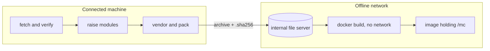

# mc-update

[](https://github.com/MorganKryze/mc-update/actions/workflows/ci.yml)
[](https://github.com/MorganKryze/mc-update/releases/latest)

mc-update keeps the MinIO client (`mc`) free of known vulnerabilities on networks that
cannot reach the internet. On a connected machine, it fetches a pinned commit of mc,
checks it against a SHA-256 kept in this repository, raises the vulnerable Go modules
and packs the whole source, dependencies included, into one archive. On the offline
side, the Dockerfile in [`docker/`](docker/Dockerfile) builds `mc` from that archive with
no network access.

MinIO archived the mc repository on 2025-11-20 and no longer publishes binaries or
images. Without this step, an `mc` binary keeps the vulnerabilities of every dependency
it carries.



## TL;DR

Connected side:

```sh
bin/mc-update all -o dist
```

```console
Fetched mc 77f82e18b540 from https://github.com/minio/mc into mc-src
Source matches sources.lock (tree sha256 19c628dca7728196...)
...
Archive: dist/mc-77f82e18b540-20261125.tar.gz (13M)
SHA-256: 7232fcf9e7cba5e1a7a252364e13867c38b39aac65a1b90409e0bf09471e528a
Needs Go 1.26.0 or later to build; tested with go1.27.4.
```

When github.com/minio/mc is unreachable, `fetch` tries the next repository in the list.
To start from an archive instead, such as one you packed before:

```sh
bin/mc-update all -a mc-77f82e18b540-20261125.tar.gz -o dist
```

Move the archive and its `.sha256` to the offline side, then build from the directory
that holds them:

```sh
docker build -f docker/Dockerfile \
  --build-arg GO_IMAGE=registry.internal/golang:1.27 \
  --build-arg MC_ARCHIVE=mc-77f82e18b540-20261125.tar.gz \
  --build-arg MC_ARCHIVE_SHA256=7232fcf9e7cba5e1a7a252364e13867c38b39aac65a1b90409e0bf09471e528a \
  -t registry.internal/mc:77f82e18b540 .
```

Other images copy the binary:

```dockerfile
COPY --from=registry.internal/mc:77f82e18b540 /mc /usr/local/bin/mc
```

## Requirements

| Side | Needs |
| --- | --- |
| Connected | `git`, `docker`, `jq`, `tar`, `sha256sum` or `shasum`; access to github.com, proxy.golang.org and vuln.go.dev |
| Offline | Docker with BuildKit, a Go image of the version `pack` names |

Neither side needs Go installed: every Go command runs in a container.

## Documentation

| Page | Read it to |
| --- | --- |
| [How it works](docs/how-it-works.md) | understand the problem, the two sides, and the six Go notions the tool relies on |
| [Source integrity](docs/integrity.md) | see how `sources.lock` proves you always build from the same source, and how to pin a new commit |
| [Commands](docs/commands.md) | use `fetch`, `check`, `bump`, `pack` and `all`, with real output |
| [Offline build](docs/offline-build.md) | build the image without network, check it, and use it in other images |
| [Configuration](docs/configuration.md) | change the repositories, the Go image, the govulncheck version or the cache |
| [Limits and troubleshooting](docs/limits.md) | see what the test build leaves to you, and fix the usual errors |

`test/run.sh` runs the tool end to end, altered archives included. The CI runs it on every
push.

## License

[MIT](LICENSE). mc itself is under the AGPL-3.0; each archive carries its license and the
licenses of its dependencies.
