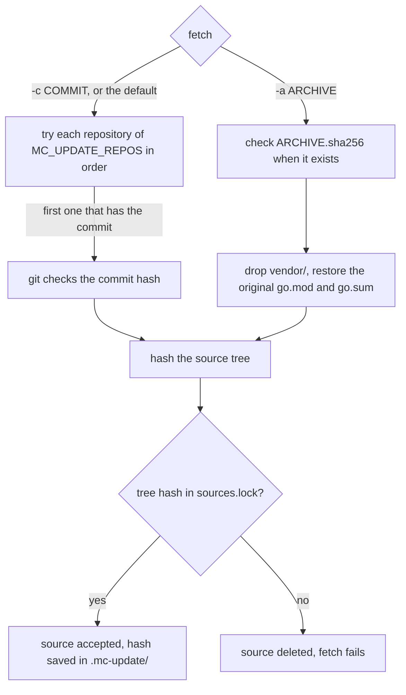

# Source integrity

mc-update builds from one known source, whatever the place it came from. A file kept in
this repository, `sources.lock`, pins each accepted commit of mc to the SHA-256 of its
source tree. `fetch` refuses any source whose tree differs.

## sources.lock

```text
# Commits of mc that mc-update accepts, with the SHA-256 of their source tree.
77f82e18b5401a65958f1619df6ebb994634bd88 19c628dca77281967763c118a1f5a3cd3c8cf6a7b03eb4f7c2c3a9039bebb797
```

One line per commit: the full commit hash, then the tree hash. The last line is the
default commit of `fetch`.

## What the tree hash covers

mc-update lists every file of the source with its SHA-256 and its path, adds every
symbolic link with its target, sorts the list and hashes it. Three rules keep the hash
stable across runs:

| Rule | Reason |
| --- | --- |
| `vendor/` and `.mc-update/` are left out | mc-update writes them |
| `go.mod` and `go.sum` count in their original state, saved in `.mc-update/` | `bump` changes them |
| The hash runs in the Go container | the same `find`, `sort` and `sha256sum` on every machine |

A changed byte, an added file, a removed file or a changed original `go.mod` gives
another hash.

## The checks, step by step



`pack` hashes the tree again before it writes the archive. A source file edited between
`fetch` and `pack` stops it.

## Repositories and fallback

`fetch` tries the repositories of `MC_UPDATE_REPOS` in order and keeps the first one that
serves the commit:

```console
$ MC_UPDATE_REPOS="https://invalid.invalid/mc https://github.com/MorganKryze/mc" mc-update fetch
  https://invalid.invalid/mc: unreachable, or without commit 77f82e18b540
Fetched mc 77f82e18b540 from https://github.com/MorganKryze/mc into mc-src
Source matches sources.lock (tree sha256 19c628dca7728196...)
```

A fork serves the same commit with the same tree: the pin holds whichever repository
answered. A fork that changed the commit cannot pass, since git checks the commit hash and
mc-update checks the tree hash.

## Archives

`fetch -a ARCHIVE` accepts any tar archive of the mc source:

| Archive | Accepted when |
| --- | --- |
| an archive made by `pack` | its source, brought back to the pinned state, matches a pin |
| the GitHub tarball of a commit (`/archive/<commit>.tar.gz`) | its tree matches a pin |

An archive made by `pack` holds raised `go.mod`, `go.sum` and `vendor/`. `fetch -a`
drops `vendor/` and restores the originals, so `bump` raises the modules again from the
pinned source with the advisories known today. Each new archive starts from the same base.

When `ARCHIVE.sha256` sits next to the archive, `fetch -a` checks it first. Without it,
the tree hash still decides.

## Pin a new commit

MinIO archived mc: a new commit would come from a fork you trust. `fetch` refuses an unpinned
commit, names the repository it came from and prints the line to add:

```console
$ mc-update fetch -c 68f1d43f056a6015ab153d3b35f4df1e06787d7e
mc-update: commit 68f1d43f056a is not in sources.lock.
It came from https://github.com/minio/mc and its source tree hashes to 62ca915442e0074e75dd308dbf84ad1533eccc440474b81a5b2fcbfcd92cf2b2.
Add this line to sources.lock only if you trust that source:
68f1d43f056a6015ab153d3b35f4df1e06787d7e 62ca915442e0074e75dd308dbf84ad1533eccc440474b81a5b2fcbfcd92cf2b2
```

Add the line in a commit of this repository, so the review of that commit is the review
of the pin.

## What the checks prove

| Check | Proves |
| --- | --- |
| tree hash against `sources.lock` | the source equals the pinned commit, file by file |
| `.sha256` next to an archive | the archive arrived whole |
| `go.sum`, checked by Go against sum.golang.org | each downloaded dependency is the published one |
| `MC_ARCHIVE_SHA256` in `docker build` | the offline build reads the archive you packed |
